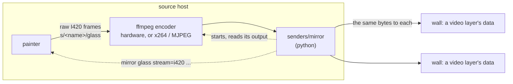

# A wall shown on other walls, as video

A mirror shows one wall's glass on any number of other walls as moving
pictures, at 25 frames a second or more, whatever is on it: a film, a
dashboard, a game. A presenter's or back-of-room screen showing the main
wall, wall to wall, with no laptop in the path. The source wall's host
encodes the glass, in hardware where it can, and each destination
decodes it on its own hardware and shows it a fraction of a second
behind the source, every destination showing each frame together. A
pairing the devices cannot carry is refused rather than run badly.
`senders/picture` and `picture glass` remain for a still.

## How it works



- **The painter gives raw frames, and nothing else**: no codec, no
  choice of hardware, no network in the painter. A controller session
  asks `mirror glass stream=i420 size=<w>x<h> fps=<n>`, and the frames
  come on a fifo of its own, `s/<name>/glass`, each a small header (its
  number, the time it was drawn on the wall's clock, its byte count) and
  the I420 planes at exactly `size`: the glass scaled with its shape
  kept, padded black where the shapes differ, 1.4 MB at 720p and 3.1 MB
  at 1080p. A frame comes every 1/fps whether the glass changed or not;
  one the reader is not ready for is dropped, newest kept. `caps` says
  `stream` where the wall offers it, and `streams=8` where it runs that
  many at once, each at its own size and rate (PROTOCOL.md, "The glass
  as a raw stream"). The painter does; the web receiver and
  `receivers/mac` do not.
- **ffmpeg encodes**, a separate process at nice 10. `senders/mirror`
  reads each glass fifo itself, takes each header off and hands the
  planes to every encoder of that stream; a frame the painter let go is
  made up by repeating the one before, so an encoder's frames stay one a
  tick, which timed playback counts on. Python moves the encoded bytes,
  a few Mb/s, never the raw frames.
- **Each destination is paired with a codec**, first that works: one the
  source encodes in hardware and the destination lists in `hw=` in its
  `caps`; H.264 by x264 in software, decoded in hardware; MJPEG where the
  destination lists `mjpeg` in `hw=`; otherwise it is refused, and the
  log says why. The source's encoders are found by trying them
  (`*_videotoolbox`, `*_qsv`, `*_nvenc`, `*_v4l2m2m`, then `libx264`;
  `mjpeg`), HEVC before H.264 where both ends do it in hardware, so a Mac
  or a Windows machine sends a Pi 5 HEVC.
- **Destinations sent the same codec, size and rate share one encode**,
  and the same bytes go to each on its video layer's `data`. Each has a
  writer and about a second's queue of its own, so a slow destination is
  skipped to the next keyframe while the others carry on.
- **Each frame is shown on the destinations' clocks.** A layer is opened
  with `fps` and a `start`: the draw time of a keyframe a second or two
  ahead, plus the lead, so frame i is shown at its draw time plus the
  lead on every destination, and walls whose clocks agree show it
  together. Each destination's clock is measured against this one as the
  mirror starts. A destination whose frames arrive late, or whose source
  jumped, is given a new layer timed afresh, the old one closed when the
  new one's first frame is due.
- **It comes back by itself.** A destination that cannot be asked at the
  start is asked again, backing off, and added when it answers; a lost
  layer is opened again, timed afresh; a lost source session is opened
  again and the stream asked for again.

## Using a mirror

### What it needs

On the **source host**, the Pi, the Mac or the Windows machine whose
wall is mirrored:

- the painter, saying `stream` in its `caps`
  (`controllers/bitwall-ctl pi-a.local:0` shows them); on a Mac or
  Windows, the painter of README.md's *The painter on a Mac* or *The
  painter on Windows*;
- ffmpeg with libx264, or a hardware encoder such as a Mac's
  VideoToolbox or Intel's Quick Sync
  (`ffmpeg -hide_banner -encoders | grep -e libx264 -e videotoolbox -e qsv`;
  in PowerShell `ffmpeg -hide_banner -encoders | Select-String libx264, _qsv`);
- on a Pi, the bitwall library and `senders/mirror` in `~/bitwall-src`
  (a Mac runs them from the repo), and the catalogue entry
  `senders/catalogue/mirror.json` in its catalogue as `bitwall/mirror`:
  `rsync -a --exclude __pycache__ senders/mirror/ pi-a.local:bitwall-src/senders/mirror/`;
- ssh keys from the source host to every destination host, and each
  destination's host key in the source host's `known_hosts`. The mirror
  writes to each destination over ssh with no one there to answer a
  prompt, so a missing key is a destination that never opens. Check from
  the source host, `ssh -o BatchMode=yes pi-b.local true`; where it asks
  about a host key, compare the fingerprint with the destination's own
  (`ssh-keygen -lf /etc/ssh/ssh_host_ed25519_key.pub` on it) before
  accepting it.

On each **destination**: a painter whose `caps` say `data` and list the
codec in `codecs=`, and `hw=` for those it decodes in hardware: H.264 on
a Pi 3, HEVC on a Pi 5, both on a Mac, which wants Remote Login on for
the source's ssh, and both on Windows, which wants its OpenSSH server
and `python3` on the path for the relay (WINDOWS.md).

### Starting and stopping it

From the controller host, the source wall last and the destinations by
commas:

```sh
controllers/bitwall-senders start bitwall/mirror pi-a.local:0 --to pi-b.local:0 --on pi-a.local
controllers/bitwall-senders start bitwall/mirror pi-a.local:0 --to pi-b.local:0 --size 1920x1080 --fps 15 --on pi-a.local
controllers/bitwall-senders status pi-a.local
controllers/bitwall-senders stop pi-a-7f3a2c --on pi-a.local
```

`--on` is the host it runs on, which must be the source's. Its catalogue
entry is placed `controller` (CONTROL.md): it holds only a controller
session on the source, which carries its instance, so it starts beside
whatever is there and takes nothing from it. The control page starts and
stops it the same way, with `Shown on` for `--to`.

Or run it directly on the source host, where Ctrl-C stops it:

```sh
ssh pi-a.local
cd ~/bitwall-src && senders/mirror/main.py localhost:0 --to pi-b.local:0
```

### Options

Each default is worked out for each destination on its own, from what
it says it decodes and the size it is sent, but the lead, which is the
most any of them wants. An option given always wins and is used as it
is.

| option | what it does | default, and why |
|---|---|---|
| `--to` | the walls that show it, `host` or `host:wall`, by commas; each may end in what it is sent, `@WxH`, `@WxH/fps` or `@/fps`, in place of `--size` and `--fps` for that one | none: it must be given |
| `--size WxH` | the most a destination is sent; never more than its glass or the source, the source's shape kept | the destination's glass, at most 1280x720: 720p25 is what a Pi 3 shows without falling behind |
| `--fps` | frames a second sent | 25. A Pi 3 at 1080p wants 15 |
| `--lead` | seconds behind the source each frame is shown, on each destination's clock, one for every destination so they show each frame together; `0` shows each as soon as it is decoded | the most any destination wants, and the log says which. 0.25 s. 0.5 s where a frame is held on its way: by VideoToolbox encoding it (a Mac source, whose frames leave it 206 to 230 ms after drawn at 720p25, and 336 ms in HEVC at 15 fps), or by a destination whose `threads` line says above 2 for what it is sent (`decoder=` in hardware, `software=` on the CPU: a painter given `--decoder-threads` above 2). 0.8 s above 720p on a destination that decodes H.264 in hardware and not HEVC, a Pi 3, whose decoder is late with every frame at 0.25 s at 1080p and smooth at 0.8 |
| `--codec` | `auto`, `h264` or `mjpeg` | `auto`: each destination is sent what it decodes in hardware, and one that decodes nothing this can send is refused. `h264` sends H.264 to any destination that takes it, decoded in software where it must be |
| `--bitrate` | Mb/s sent to each destination, at the size and rate sent | 3 x (w x h x fps) / (1280 x 720 x 25), at least 0.3, and three times that for MJPEG: 3 at 720p25, about 6.75 at 1080p25 and 4 at 1080p15. 3 Mb/s at 720p25 is crisp enough for a preview |
| `--pull` | run on a destination's host, the encode started on the source's host through ssh (*Pulling*) | off: it runs on the source's host |
| `--place` | where on each destination: `auto`, `above`, `top`, or a layer's number; `0` is its base, taken from whoever holds it | `auto`: the base where nobody holds it, above the base where somebody does (*Where it goes*) |

x264 runs `ultrafast`, `tune=zerolatency`, no B-frames, headers
repeated, a keyframe every 2 s, two threads; Quick Sync with
`-async_depth 1`, so a frame leaves as soon as it is made. The stream
is BT.709 at limited range and says so.

### Destinations of different sizes

A projector and a preview screen want different things: the projector
the whole of the glass, a small screen less of it and perhaps fewer
frames. Each destination may say its own after an `@`:

```sh
controllers/bitwall-senders start bitwall/mirror pi-a.local:0 \
    --to pi-b.local:0@1920x1080/15,pi-b.local:1@640x360 --on pi-a.local
```

What a destination is sent is the source's shape, as big as fits both
its ceiling (its `@WxH`, else `--size`, else 1280x720) and its glass,
and never bigger than the source; so a 1280x720 glass goes to a
1920x1080 destination and a 1280x720 one alike at 1280x720, and the log
says each, `hevc at 1280x720 25fps (its glass 1920x1080)`. The
destination scales each frame to the largest that fits its glass with
its shape kept, centred (PROTOCOL.md, "The data pipe"), so a frame
smaller than the glass is shown full size, softer.

A source whose `caps` say `streams=<n>` is asked for one stream for each
size and rate sent, so each encode is given its frames at its own size
and none is scaled twice; the log says which it asked for. A source that
says `stream` alone runs one stream, so it is asked for one at the
largest size and the highest rate, and an encode for less scales it down
and takes the frames it wants of it. Either way the destinations see the
same thing.

### Where it goes

A painter whose base nobody holds dozes its display: it shows its status
page and then goes dark, and a layer over that base is not seen. So by
default a mirror takes a destination's base where it is free, which
lights the display, and goes above the base where a sender holds it,
which leaves that sender where it is. The choice is made again whenever
the mirror opens a layer there, and the log says which. `--place 0`
takes the base even from a sender holding it; `--place above` never
takes it.

### Pulling

A mirror may run on a destination's host instead, with `--pull`, and
pull the source's glass to it: for a source that cannot reach the
destination, as a Pi cannot open ssh to Windows, where the destination
can reach the source. A laptop's HDMI captured on a Pi's screenless wall
(`senders/hdmi` on `pi.local:hdmi`), say, shown on a Windows machine's
wall, which pulls it; nothing runs on the Pi but what the mirror starts
there and stops again:

```sh
senders/mirror/main.py pi.local:hdmi --to localhost:0 --pull
controllers/bitwall-senders start bitwall/mirror pi.local:hdmi --to localhost:0 --pull
controllers/bitwall-senders stop <id>
```

The second is the same through the destination host's catalogue, run on
that host (no `--on`, or `--on` the destination's host); `stop` ends it,
and what it started on the source with it.

**The encoder still runs on the source's host**, since the raw glass is
far too heavy for ssh (34.6 MB/s at 720p25). The mirror holds its
controller session on the source and asks for the stream there, one
stream for each encode, by name; then it starts the encode through the
source's ssh: `there.py`, carried on the command line as the relay is,
so the source keeps no copy, reads the painter's fifo there, fills the
frames the painter let go, and feeds ffmpeg at nice 10. What comes back
over that ssh is ffmpeg's output and, before each frame's output, the
time that frame was drawn, on the source's clock and turned to this
one's with the offset measured as the mirror starts. From there it is a
mirror like any other: the same timing, the one lead, the same
destinations, local (`localhost:0`) or anywhere this host reaches. Its
log names the encode `... on pi.local`, and says each minute how much
came over ssh.

**What is encoded is what the source's host encodes** and the
destination decodes in hardware, tried there in one ssh as the mirror
starts. A Pi 5 has no hardware encoder, so it sends H.264 by x264 to a
destination that decodes H.264 in hardware (a Mac, Windows, a Pi 3), and
MJPEG to one that says `mjpeg` in `hw=`; a Pi 5 destination is refused
as from a Pi 5 source (*Pi 5 destinations*).

**Its encoder is run again when it ends**, backing off from two seconds
to half a minute, and each destination is timed afresh on the new one.
It ends when the mirror stops (its ssh ends, and ffmpeg there with it),
when its ssh dies, and when the stream it reads goes. Killing ffmpeg on
the source puts the picture back about six seconds later.

**Where it does not apply.** A source on this host (pull is for a source
elsewhere) or on Windows (run the mirror there, which encodes on Quick
Sync) is refused. Pulling, each encode reads a painter stream of its
own, so a source that runs one stream at a time (`stream` alone in its
`caps`) feeds one encode, and a destination wanting another is refused.

### Pi 5 destinations

A Pi 5 decodes HEVC in hardware and H.264 only in software, and a Pi 5
source encodes only H.264 (x264, in software), so with `--codec auto` a
Pi 5 destination of a Pi 5 source is refused, and the log says so.
Nothing is decoded in software unless asked for: `--codec h264` sends it
H.264 to decode in software; watch its CPU.

## A Windows host

A wall on Windows is a source and a destination as any other, and the
mirror runs there with Windows' own Python, from a copy of the repo
(README.md, *The painter on Windows*). Windows looks up no `.local`
names, so a Pi is reached by its address, and a Mac by its address or a
`Host` alias in `~/.ssh/config`:

```powershell
$env:PATH = "C:\Program Files\Git\usr\bin;" + $env:PATH
python3 senders\mirror\main.py localhost:0 --to 192.0.2.10:0,192.0.2.10:1,192.0.2.11:0
```

The first line is not optional in an ssh session: Windows' own `ssh`,
started by the mirror there, never exits, and every destination is then
one it cannot ask (WINDOWS.md). Run by hand, the mirror's log is its
stdout, a line each, dated; to keep it, `> mirror.log`. It lives as long
as the ssh session unless started as WINDOWS.md, *Keeping it running*,
says, or by `bitwall-senders` on a Windows sender host (WINDOWS.md, *A
sender host*).

The ssh user for every destination is the Windows user, or
`BITWALL_PI_USER`, one name for every host; an alias's `User` is not used
(README.md, *On Windows*), so every destination of one mirror takes the
same user.

- **As a source** it reads each glass stream's named pipe in its own
  process, through `bitwall/local.py`, as a sender there opens its
  session; ffmpeg is `BITWALL_FFMPEG`, else Chocolatey's own (not its
  shim, so the encoder is the mirror's child), else the first on the
  path, run below normal priority. Quick Sync is found by trying, as
  VideoToolbox is on a Mac: `hevc_qsv` to a destination decoding HEVC in
  hardware, `h264_qsv` to one decoding H.264. Ctrl+C or Ctrl+Break stops
  it.
- **As a destination** its clock is asked through `relay clock`, which
  answers once a line on a relay already running, so the time is not
  read at the end of ssh's, PowerShell's and Python's start; and so is
  every destination's where the mirror runs on Windows, whose ssh opens
  a connection a command and would read `date` just as late.
- **A Windows source mirrored from another host** is read through
  `relay read`, the raw frames over ssh: 34.6 MB/s at 720p25, more than
  a Wi-Fi link carries (to a Mac, 20 fps came, each 389 ms after drawn).
  Run the mirror on the Windows host itself, or send less
  (`--size 960x540`).

On an Intel laptop the painter says about 100% of a core throughout,
which is Intel's GL driver spinning in an ssh session (WINDOWS.md), not
the stream; and now and then a second plays at 12 to 16 fps, the
painter's decoder there, seen with films on `data` too.

## What was measured

Each over Wi-Fi, a film or a moving picture on the source unless it says
otherwise. *Left the source* is how long after it was drawn each frame
left the source host; *least margin* the least time any frame had to
spare when it reached its destination. Picture differences are `picture glass` of the source
and the destination, a still test card scaled to 640x360, mean absolute
difference out of 255.

| source, encoder | destination | sent | lead | at the destination | cost |
|---|---|---|---|---|---|
| a Pi 5, x264 | a Pi 3, H.264 in hardware | 720p25, 3 Mb/s | 0.25 s | 23.5 to 25 fps; left the source 50 ms after drawn, least margin +190 ms; crisp enough for a preview, soft on a big TV | Pi 5: x264 27% of a core, the mirror 6%, the painter 13% more for the stream. Pi 3: the painter 15 to 17%, 65 °C |
| a Pi 5, x264 | a Pi 3 | 1080p25, 18 Mb/s | 0.25 s | falls behind: every frame late and dropped; not usable | x264 69% of a core |
| a Pi 5, x264 | a Pi 3 | 1080p15, 9 Mb/s | 0.25 s | every frame late, the picture frozen | |
| a Pi 5, x264 | a Pi 3 | 1080p15, 9 Mb/s | 0 | 15 fps, none dropped, decode 8 to 9 ms; slightly choppy | |
| a Pi 5, x264 | a Pi 3 | 1080p15, 9 Mb/s | 0.8 s | 15 fps, none dropped, decode 10 to 14 ms; smooth and crisp on a big TV | x264 about 40% of a core |
| a Pi 5 (an HDMI capture, mostly still), x264, pulled | an M-series Mac, one decoder thread | H.264 720p25, 3 Mb/s | 0.25 s | 24.6 to 25.6 fps, none dropped after the first, decode 1.5 to 3.4 ms; left the source 62 to 66 ms after drawn, least margin +142 to +156 ms; 345 to 377 kB/s over ssh; about 7 s from start to picture | Pi 5: x264 31 to 32% at nice 10, `there.py` 7%, the painter 15% more. Mac: the mirror 1.3% |
| Windows 11 on an Intel laptop, Quick Sync | a Pi 5, HEVC in hardware | HEVC 720p25, 3 Mb/s | 0.25 s | 24.0 to 25.7 fps, 11 dropped as it started and none after; left the source 55 ms after drawn; picture 0.65, 99th percentile 7 | 23% of a core: Python 4.7%, ffmpeg 15%, ssh 3.3% |
| the same | a Pi 5 | HEVC 1080p25, 6.75 Mb/s | 0.25 s | 24 to 26 fps, decode 1.3 to 1.6 ms | 37%: Python 15%, ffmpeg 18%, ssh 3.7% |
| the same | a Pi 5's two walls and a Mac, one encode | HEVC 720p25, 3 Mb/s | 0.5 s | all 25 fps, none dropped after the start; the Pi 5 and the Mac against each other 0.27 and 0.32 | Python 9% |
| an M-series Mac, VideoToolbox | Windows 11, Intel laptop | H.264 720p25 | 0.5 s | 25 fps, decode 0.5 to 1 ms, now and then a second at 12 to 16 fps; picture 0.79, 99th percentile 5 | the destination's ffmpeg 13% |
| the same | the same | HEVC 720p25 | 0.5 s | as H.264; picture 0.72, 99th percentile 4 | the destination's ffmpeg 16% |
| the same | the same | HEVC 720p25, 3 Mb/s | 0.25 s; 0.3 s | 0.25: a second or two of frames dropped after the start; 0.3: none after the start | |
| the same | two walls of the Mac's own painter | HEVC 720p25 | 0.25 s; 0.2 s | 0.25: 25 fps, 3 dropped as it started; 0.2: every frame late | |
| Windows 11, Intel laptop, its glass read through `relay read` by a Mac encoding on VideoToolbox | a Pi 5 | HEVC 960x540 25 | 0.5 s | 24.5 to 25.5 fps, none dropped; picture 1.12, 99th percentile 11 | Windows: the relay 1.8%, sshd 21% |

The encoders alone, at 25 fps real time: on a Pi 5, x264 `ultrafast` at
two threads and nice 10 takes 32% of a core at 720p and 69% at 1080p,
and ffmpeg's MJPEG 37% and 77%. On a Pi 3 at 720p25, ffmpeg decoding
H.264 in hardware takes 38% of a core including the copy out of the
decoder, at 3 Mb/s; MJPEG in software 62%, at 10 Mb/s.

**A destination's decoder holds a frame for each thread it runs,** even
in hardware. An HEVC 720p25 stream written at 25 fps straight into a
Mac painter's decoder, nothing held by an encoder:

| decoder threads | each frame out of ffmpeg after written | least lead that played |
|---|---|---|
| 8 | 325 ms | |
| 4 | 165 ms | between 0.12 and 0.15 s |
| 2 | 85 ms | |
| 1 | 45 ms (48 in software) | 0.02 to 0.03 s |

So the painter runs one decoder thread where a hardware decoder does the
work, and a Mac as a destination wants no more lead than a Pi; a Pi 5
from a Mac played at between 0.05 and 0.1 s. The painter says its
threads in its `threads` line, and the mirror asks for 0.5 s of every
destination where one runs more than two.

## When it goes wrong

The mirror's log is `~/.bitwall/running/<id>.log` on the host it runs on
(the control page shows its end); run by hand, it is the mirror's
stdout. It says what each destination was given and why, and once a
minute how each stands: frames sent, MB, how long after it was drawn
each frame left the source (`sent ... ms after drawn`), and the least
margin any frame had before it was due there (`least margin`, the first
minute's including the start). A destination's own view is in its
measures:

```sh
controllers/bitwall-ctl --follow pi-b.local:0 measures 1000
```

Its layer's line says `fps` shown, `dropped` and `decode` in ms.

**Each destination's clock is measured on its own**, once, as the mirror
starts: the quickest of seven answers from that host, timed on this one.
The log says each that differs, `192.0.2.10:1: clock -473 ms against
this one`; the mirror's own host is not said, and one that `did not say
its time` is taken to be this one's. The offsets are kept for the run: a
clock that is stepped while it runs puts that destination out until the
mirror is restarted. Never take a host's clock to be right: the mirror
measures it and allows for it.

### Checking that walls play together

Which frame a destination has up is judged by what each says and by
pictures:

1. **The log's first lines.** `lead 0.5s for every destination (auto:
   mac.local:0)`, the lead and the destinations that wanted it, each of
   which says why on its own line (`wants a lead of 0.5s (decoder
   threads 4)`); and a `clock ... against this one` for each host that
   differs. Two walls of one host share a clock and an offset.
2. **The log's minute lines.** A least margin above zero for every
   destination after the first minute: each frame reached each wall
   before it was due on that wall's clock.
3. **Each destination's measures**, followed at once: the layer's `fps`
   the rate sent and `dropped` standing still. A wall whose `dropped`
   climbs is late, and shows nothing or freezes.
4. **Pictures taken together.** `picture glass` of each destination
   asked at the same moment, each scaled to 640x360 and compared: two
   walls showing the same frame differ by well under 1 of 255 on
   average, and by several where they are a frame or more apart (against
   the source, half a second ahead, about 4.6). Moving content tells; a
   still one cannot. A layer over the mirror on one destination makes
   its picture differ for that reason alone; `sessions` says what is
   above it.

```sh
for w in pi-b.local:0 pi-b.local:1 localhost:0; do
    controllers/bitwall-ctl $w picture glass --png --out "${w/:/_}.png" &
done; wait
```

### What it means

- **The picture is frozen, and the destination's `dropped` climbs.** The
  frames reach it after they are due and are let go: the lead is too
  short for that link and decoder. Raise `--lead`, or send less
  (`--size`, `--fps`). A least margin near or below zero in the
  mirror's log says the same.
- **Choppy with `--lead 0`.** Shown as decoded, each frame goes up when
  it happens to arrive. Give it a lead, so frames are shown on the
  destination's clock one a tick.
- **Colours slightly shifted** on one destination against another. The
  stream is BT.709 at limited range and says so; a decoder that ignores
  that and assumes BT.601 shifts the colours a little. It is the
  decoder's, not the stream's.
- **A destination is refused.** The log says why: it decodes nothing
  in hardware that the source can send (a Pi 5 from a Pi 5), or it takes
  no such codec. A refusal is for the run.
- **A destination is waiting**, `cannot ask it yet: ...; asking again,
  backing off`: it could not be asked as the mirror started, which is
  the network or ssh (*What it needs*), not an answer. The mirror starts
  without it, even with no destination at all, and asks again from a
  second apart to half a minute, saying only a new reason (`still cannot
  ask it: ...`). Once it answers (`answered`) it is chosen for as at the
  start, its clock measured, and added: to the encode of its codec, size
  and rate where there is one, else a new encode, and a new painter
  stream only where the source runs another (`streams=`); where the
  source's streams are all taken and none is at its size and rate or
  more, it is refused. It plays at the lead the others already play at,
  since timing them afresh would break every picture already up; where
  it wants more the log says so, `it plays at 0.25s and may drop
  frames`, and a restart or `--lead` gives it more. Where nobody
  answered at the start, the first to answer sets the lead.
- **A destination never opens**, `cannot open a layer` in the log: a
  full wall, or ssh again.
- **The source does not stream.** The source's painter does not say
  `stream` in `caps`: it is older, or not a painter.

## Limits

A mirror carries no sound. Each destination's size and rate are fixed
for the run: one that drops frames is not stepped down.
