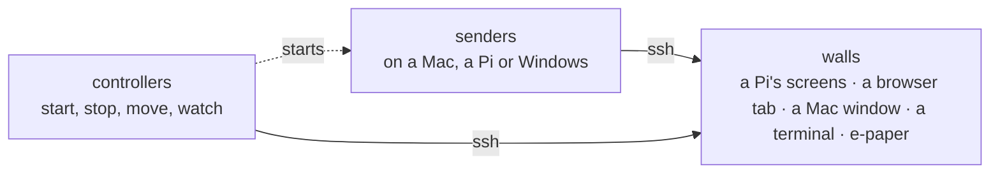
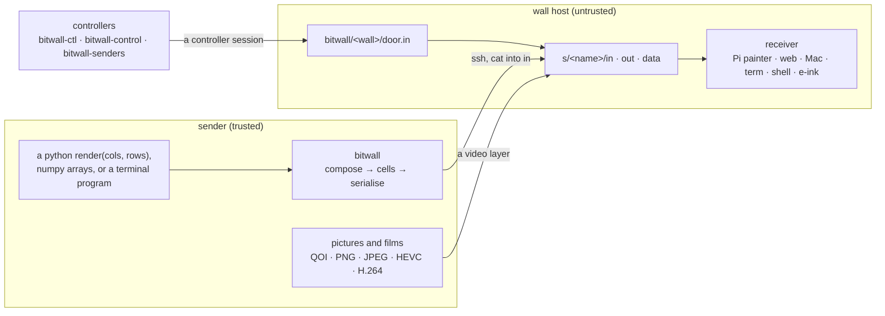
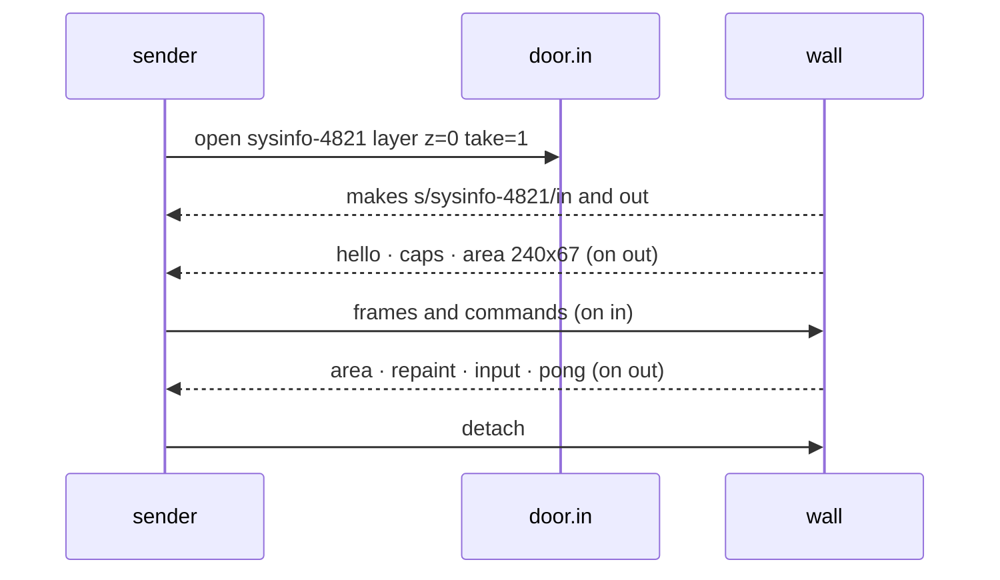
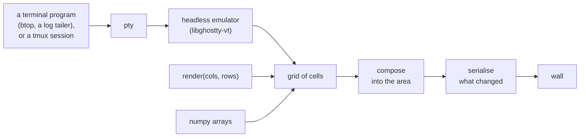

# bitwall

**Send text and pixels to any screen, from anywhere.**


*Everything in the reel is bitwall, captured straight off a wall.*

Drive screens from programs you write. A **sender** computes a picture and
streams it to a **wall**; the wall's **receiver** paints it and knows
nothing else. All the work, data and credentials stay on the sender; a wall
is a screen on a dumb machine: a Raspberry Pi's HDMI outputs, a browser
tab, a window on a Mac, a terminal, a panel of electronic paper.

What a wall can show, from the senders here:

- **dashboards and text** in cells, truecolor, with big text in eleven
  fonts (`senders/sysinfo`, `senders/letters`)
- **self-playing games** and animation (`senders/games`, `senders/fluid`)
- **pictures and films**: a JPEG on a layer, a film decoded on the
  receiver's own hardware, full screen or in a box over whatever is
  beneath, one film cut across several screens (`senders/picture`,
  `senders/film`)
- **HDMI in** from a laptop through a capture dongle (`senders/hdmi`)
- **one wall shown on others** as video, encoded on the source's host and
  decoded on each wall's hardware (`senders/mirror`; setting one up,
  its options and measured rates are in
  [MIRROR.md, *Using a mirror*](MIRROR.md#using-a-mirror))
- **several senders at once**, as layers over one another or as panes side
  by side (`senders/ticker`, `senders/panes`)



The quick start below gets a wall going on a Mac, then on a Pi; the
reference follows. docs/writing-a-sender.md is the guide to writing a
sender, AGENTS.md the guide to working on bitwall itself, PROTOCOL.md the
contract, and the other documents are listed under *Layout and
documents*.

## Quick start

Everything runs under [uv](https://docs.astral.sh/uv/), which reads each
script's dependencies from the top of the file. Clone the repo on the Mac
and run from its root.

**A Mac alone.** No Pi needed: a web wall on this machine is a wall like
any other.

```sh
bitwall/receivers/web/bitwall-web kitchen     # a wall named kitchen, port 8901
open http://localhost:8901/r/kitchen          # its glass
senders/hello.py localhost:kitchen            # the smallest sender
senders/sysinfo/main.py localhost:kitchen     # a dashboard
controllers/bitwall-ctl localhost:kitchen     # what the wall is and can do
```

**A Pi and a Mac.** The Pi runs the painter and nothing else; the senders
run on the Mac and reach the Pi over ssh.

1. Set up the painter on the Pi as in *Setting up a Pi*, below.
2. Make sure the Mac reaches the Pi by ssh with a key and no prompt, as
   the same user, or set `BITWALL_PI_USER`: `ssh pi.local true`.
3. Run a sender on the Mac with the Pi as its wall: `pi.local`, or
   `pi.local:1` for its second screen.

```sh
senders/sysinfo/main.py pi.local
controllers/bitwall-ctl pi.local              # what the wall is and can do
```

`bitwall/` is the tool and carries nothing machine-specific. `senders/` are
examples of what it can do; senders drawn from one person's own devices and
accounts belong in a repository of their own, linked into the catalogue
(CONTROL.md).

## Install

The sender library is the `bitwall` package. Pin it to the `v1` branch,
which follows the latest 1.x release, and so the v1 protocol every wall
speaks.

```sh
uv add "bitwall @ git+https://github.com/iamrodos/bitwall@v1"
pip install "bitwall[all] @ git+https://github.com/iamrodos/bitwall@v1"
```

Extras: `arrays` (numpy), `letters` (Pillow, for TILE and the outline
fonts), `all`. A terminal program on a wall, `CommandSource` or
`TmuxSource`, needs the emulator built once from a clone: `bitwall/vt/build`
(git and zig), which builds Ghostty's libghostty-vt at a pinned commit
into `bitwall/vt/lib/`. A sender can be one script:

```python
# /// script
# requires-python = ">=3.10"
# dependencies = ["bitwall @ git+https://github.com/iamrodos/bitwall@v1"]
# ///
import bitwall
w = bitwall.attach("pi.local")
```

In Rust: `bitwall = { git = "https://github.com/iamrodos/bitwall", branch = "v1" }`.
Receivers run from a clone. Versions and releases: [RELEASING.md](RELEASING.md).

## Receivers

| receiver | where | paints |
|---|---|---|
| `bitwall/receivers/pi` | the painter: on a Raspberry Pi one wall per HDMI output; on a Mac or Windows a window, or no screen at all | composes on the GPU (`bitwall-paint.c`): through KMS and GLES on a Pi, decoding HEVC on a Pi 5 and H.264 on a Pi 3; desktop GL, VideoToolbox, D3D11VA or Quick Sync elsewhere; streams its glass raw for the mirror |
| `bitwall/receivers/web` | a browser tab, `bitwall-web kitchen` then `/r/kitchen` | named walls on a server; the tab stacks and paints the layers, and decodes films with WebCodecs |
| `bitwall/receivers/mac` | a window on a Mac | the web receiver's page in a native window |
| `bitwall/receivers/term` | the terminal it is run in, on Windows, a Mac or Linux | the stream read into a grid, cells layers stacked over it, the stats overlay, pictures and mirrors of its cells, and the terminal's keys and clicks as input (its README.md) |
| `bitwall/receivers/shell` | the terminal it is run in | the least a receiver can be, in `sh`; `bitwall-ps.ps1` the same on a Windows console, its pipes named pipes |
| `bitwall/receivers/eink` | a Waveshare 10.3" IT8951 e-paper HAT, on a Raspberry Pi's SPI or on USB from any machine | cells, cells layers and pictures composed in sixteen greys, on paper black ink on white, pushed to the panel once the senders pause, or every two seconds for one that never does (its README.md) |

`bitwall/receivers/core-rs` is the wall itself for a receiver in Rust: the
door, the sessions and every command of PROTOCOL.md, ported from
`receivers/core.py`, so a receiver built on it brings only a glass and
draws. `term` and `eink` are built on it (its README.md).

The Pi painter is the reference: where the protocol leaves a choice, the
others do what it does, and `tests/bitwall-contracts` holds them all to the
same clauses.

## Writing a sender

A sender is a normal program that imports bitwall. One line puts the repo on
the path:

```python
import signal, sys, threading
sys.path.insert(0, "/path/to/bitwall")     # the repo root
import bitwall

def render(cols, rows):                    # a grid of cells, rows of cols
    return [[bitwall.cell("·", "444444") for _ in range(cols)] for _ in range(rows)]

w = bitwall.attach("pi.local")
w.meta(name="Dots", description="the smallest thing that draws")
with w.transition():                       # font and source change as one move
    w.set_font_size(18)
    w.set_source(render)
cols, rows = w.area()                      # always ask; never assume

stop = threading.Event()
for sig in (signal.SIGINT, signal.SIGTERM):
    signal.signal(sig, lambda *_: stop.set())
stop.wait()
w.detach()                                 # tells the wall it is free
```

A source is a function of the area, `bitwall.FunctionSource(arrays=...)`
for one that already holds numpy arrays, `bitwall.CommandSource("btop")`
to run any terminal program, or `bitwall.TmuxSource(session, sock)` to show
a tmux session. Big text is `bitwall.letters`; a
picture goes on a layer with `bitwall.layer(target).frame(jpeg, ...)`. A
simple sender is a single file (`senders/hello.py`); a complex one is a
directory. docs/writing-a-sender.md has the rest: what to print, how to
stop, drawing at this resolution, and the traps that have cost time.

### In Rust

A sender whose picture is expensive to make can be written in Rust, on
`bitwall/rust`: the same contract and, for the same frames, the same bytes,
so the walls need nothing new. `senders/games/cells/rust` is cells in Rust,
30 fps at 1706x480 where the Python one makes 5. Building it, the API and
its limits are in `bitwall/rust/README.md`.

### On Windows

A sender runs on Windows with nothing but Python, uv and Windows' own
OpenSSH client, and draws on any wall it can ssh to:

```bat
uv run senders\hello.py 192.0.2.10:1
uv run --script controllers\bitwall-ctl 192.0.2.10:1
```

A script whose name has no `.py` needs `uv run --script`. Those two lines
are for a console on the machine. **In an ssh session to Windows**, uv's
own Python will not start for a script (WINDOWS.md, *Traps*), so give
uv the Store's Python, or the script's dependencies by hand:

```powershell
uv run --python (Get-Command python3).Source --script controllers\bitwall-ctl localhost:0
uv run --no-project --with numpy --with pillow python senders\picture\main.py localhost:0
python3 controllers\bitwall-ctl localhost:0     # a script whose dependencies it never imports
```

The first is Python 3.12, which runs a script asking for 3.14 with a
warning. A sender in an ssh session on Windows drawing on another
host's wall wants Git's `ssh` ahead of Windows' own on the path (WINDOWS.md,
"Windows' ssh, run from a program in an ssh session"); one drawing on
`localhost` runs no ssh at all. A process started in an ssh session ends
with it; WINDOWS.md, *Keeping it running*, has what outlives it.

The key for the wall's host is the one `ssh` uses, with `BatchMode` on, so
it has to work without a prompt. The user is the one this machine logs in
as, or `BITWALL_PI_USER`, one name for every host: bitwall puts
`user@host` on ssh's command line, so a `User` in `~/.ssh/config` is not
used, though its `HostName` is (`Host pi` / `HostName 192.0.2.10`
makes `pi:0` a wall). Windows does not look up `.local` names, so a Pi
is reached by its address, a name the network's DNS knows, or such an
alias. A film needs ffmpeg on the
path, and encodes on the machine's own hardware where it has an Nvidia,
Intel or AMD encoder. Windows' ssh has no `ControlMaster`, so each session
makes a connection of its own; what else is different there is in
`bitwall/portable.py`. A Windows machine has walls of its own with the
painter ("The painter on Windows", below), and with `bitwall-web`
(WINDOWS.md, *A web wall on Windows*), and runs the control page,
`bitwall-control` (WINDOWS.md, *The control page on
Windows*). Not on Windows: the terminal sources and the `pane-*` terminal
front ends.

## Controllers

A controller talks to walls directly, never through their senders, on a
controller session of its own at the wall's door.

```sh
controllers/bitwall-ctl pi.local:1                       # what the wall is and can do
controllers/bitwall-ctl pi.local stats 1 show=all        # a command, and its answer
controllers/bitwall-ctl --follow pi.local:1 measures 500 # the glass, then a line a session every 500 ms
controllers/bitwall-control                              # every wall on one page, port 8910

controllers/bitwall-senders list                         # what can run on this host
controllers/bitwall-senders start bitwall/fluid pi.local:1   # a sender from the catalogue
controllers/bitwall-senders status                       # what runs where
controllers/bitwall-senders move mac-7f3a2c pi.local:0   # to another wall, still running
controllers/bitwall-senders stop mac-7f3a2c
```

What a host can run is its catalogue, `~/.bitwall/senders/`, a `.json` per
sender with its label, start script, options and place; bitwall's own are
in `senders/catalogue/`. An entry may name an `available` script, which
says whether the sender can run on this host (`hdmi` needs a capture
dongle), and a host hides senders it never wants offered in
`~/.bitwall/catalogue.json`. CONTROL.md has the rest. `bitwall-control` finds
its devices in `~/.bitwall/devices.json` (`controllers/devices.example.json`),
or `--devices FILE`, `--device NAME=HOST` or `$BITWALL_DEVICES`.
A wall started with a presence goes dark in an empty room, and its sender
stops drawing, when a controller tells it nobody is there (PROTOCOL.md,
*`presence` is whether anybody is there*). `controllers/presence-example`
is a skeleton of one, to copy and give a real check: a sensor, a light
switch, a screen lock.

## Setting up a Pi

A Pi is a wall and needs only the painter: `bitwall/receivers/pi/` in
`~/bitwall/`, built there from a clone of the repo. Every `.c` and `.h`
beside `bitwall-paint.c` goes with it: a Pi builds only its own seams, but
the version is worked out from them all. The font beside them,
`MesloLGSNerdFontMono-Regular.ttf` (Apache 2.0, `MesloLGS-LICENSE.txt`),
goes in `~/.local/share/fonts/`; it is the one font the painter draws
cells in on every machine, and on a Mac the painter finds it beside
itself.

```sh
sudo apt install git libsdl2-dev libsdl2-ttf-dev libdrm-dev libgles2-mesa-dev libpng-dev \
    libjpeg-dev
git clone <this repository> ~/bitwall-src
cp -r ~/bitwall-src/bitwall/receivers/pi ~/bitwall
mkdir -p ~/.local/share/fonts
cp ~/bitwall/MesloLGSNerdFontMono-Regular.ttf ~/.local/share/fonts/
make -C ~/bitwall
printf '#!/bin/sh\nexec ~/bitwall/bitwall-screen --font 14\n' > ~/bitwall/start
chmod +x ~/bitwall/start
mkdir -p ~/.config/systemd/user
cp ~/bitwall/bitwall-screen.service ~/.config/systemd/user/
sudo loginctl enable-linger $USER
systemctl --user enable --now bitwall-screen
```

The unit runs `~/bitwall/start`, the one file that differs between Pis: it
runs `bitwall-screen` with the font, what each wall follows for presence,
and which way up each screen hangs: `--rotate 0=180` turns wall 0's
picture half a turn, for a screen mounted upside down, and `90` or `270`
a quarter clockwise or anticlockwise, for one on its side, which the wall
then says is taller than wide. Each is `WALL=VALUE`, as `--presence` is,
since one painter drives every screen on the Pi. Films need ffmpeg on the
Pi. To update it, pull the clone, copy the painter's sources again and
`make`; a painter at another version than the repo's is shown so on the
control page.

A sender can run on a Pi too, from its clone, as on any sender host: its
catalogue is `~/.bitwall/senders/` there (CONTROL.md).

## The painter

`bitwall-paint` is one program on every machine, built beside its
sources in `bitwall/receivers/pi/`: `make` on a Pi, `make PLATFORM=mac`
on a Mac, `mingw32-make PLATFORM=windows` in MSYS2's UCRT64 (below); `OUT=` writes it
elsewhere. Each wall it keeps composes once into its **glass**, which
goes to a screen, a window, or nowhere, and to any raw streams a
controller asks for (PROTOCOL.md, *The glass as a raw stream*), which
is what the mirror encodes (MIRROR.md). `bitwall-paint --help` says its
options:

    --run DIR             keep walls as DIR/bitwall/<n>/, n from 0, and speak
                          the protocol. DIR is the host's run directory
                          (PROTOCOL.md, *The run directory*), where senders
                          look: /run/user/<uid> on a Pi, ~/.bitwall/run on a
                          Mac, a directory that must exist;
                          //./pipe/bitwall-<user> on Windows. Without it the
                          painter paints a stream on its stdin.
    --glass WxH           no screen: every wall's glass is WxH, and a
                          controller may change it (`glass WxH`); a Mac
                          and Windows
    --driver NAME         SDL's video driver: kmsdrm on a Pi, cocoa on a Mac,
                          windows on Windows; `none` is no screen, each glass
                          as --mode says, on a Mac and Windows; on a Pi no
                          screen is `offscreen`, on its GPU through EGL
    --walls auto|N        how many walls: on a Pi, `auto`, one for each screen
                          connected (bitwall-screen asks for it); in windows,
                          one, or `auto` for a window on every display; with
                          no screen, one, or N
    --display N           the one screen used, where there are several
    --mode WALL=WxH       a wall's size: the mode its screen is set to on a
                          Pi, its window in real pixels, or its glass with no
                          screen; 1920x1080 unless said
    --rotate WALL=0|90|180|270
                          how far clockwise a wall's picture is turned, for a
                          screen hung that way
    --presence WALL=NAME  the presence a wall follows (PROTOCOL.md)
    --name WALL=NAME      a wall's name in place of its number, for a
                          painter beside another in the same run directory:
                          `--driver offscreen --mode 0=1920x1080 --name
                          0=hdmi` on a Pi is a wall with no screen beside
                          its screens, reached as <host>:hdmi
    --font N              the cell font size a wall starts at; 14
    --font-file PATH      the font, by default MesloLGSNerdFontMono-Regular.ttf
                          beside the painter, else among the user's fonts

The painter's thread that draws never waits on a picture: a video
layer's frames are decoded, and pictures and mirrors of the glass
encoded, by a few worker threads, and a film's ffmpeg runs niced. The
knobs are options of the painter's, which `bitwall-screen` hands on, the
same on every platform:

    --workers N           the worker threads; by default half the cores,
                          one to four; 0 does the work on the thread that
                          draws.
    --decoder-threads N   ffmpeg's -threads for a film on `data`; by default
                          1 where a hardware decoder or hwaccel does the
                          work, since each thread holds a frame on its way
                          (4 held each 165 ms on a Mac, 1 held it 45), and
                          as many as the workers where ffmpeg decodes on
                          the CPU, two at most on a machine of 2 GB or less
    --decoder-nice N      how far below the painter ffmpeg runs, 0 to 19;
                          by default 5. On Windows above 0 is below normal
                          priority, and 15 and up idle.

`report` says what they came to (`threads cores=4 workers=2 decoder=1
software=2 nice=5` on a Pi 3: `decoder` in hardware, `software` on the CPU), and the painter's log says them as it starts.

## The painter on a Mac

The painter builds on a Mac with Homebrew's libraries and runs there in
a window, on the Mac's own GPU, or with no screen at all, its glass a
size it is given. A Mac's run directory is `~/.bitwall/run`, so a sender
on the Mac reaches its first wall as `localhost:0` and one elsewhere as
`<mac>.local:0`.

```sh
brew install sdl2 sdl2_ttf libpng jpeg-turbo ffmpeg pkg-config
cd bitwall/receivers/pi
mkdir -p ~/paint ~/.bitwall/run
make PLATFORM=mac OUT=$HOME/paint/bitwall-paint
cp MesloLGSNerdFontMono-Regular.ttf ~/paint/
~/paint/bitwall-paint --run ~/.bitwall/run --mode 0=1280x720    # a window
~/paint/bitwall-paint --run ~/.bitwall/run --glass 1920x1080    # no screen
```

The window may be resized, and the wall takes the new size once it has
held for 300 ms. Films on `data` are decoded by ffmpeg on VideoToolbox,
HEVC and H.264 in hardware (`hw=hevc,h264` in `caps`), so a Mac is a
mirror destination as a Pi is. Nothing keeps it alive: it stops on
Ctrl+C, and its walls go with it.

## The painter on Windows

The painter builds on Windows in MSYS2's UCRT64 shell and runs there as a
wall in a window, or with no screen, its glass a size it is given. Its
walls are named pipes under `//./pipe/bitwall-<user>` (WINDOWS.md), so a
sender on the same machine reaches it as `localhost:0` and one anywhere
else as `<host>:0`, through ssh and the relay.

The source is a copy of the repo on the machine, in the user's
`Documents`: `git pull` in a clone keeps it current from a console, but
not from an ssh session, where Git's credential manager cannot reach its
store; from a Mac, `git archive HEAD | ssh <host> 'tar -xf - -C
C:\Users\<user>\Documents\bitwall'` writes the tree over the copy there
(a tar piped so to PowerShell's `tar` arrives byte for byte).
In UCRT64, once:

```sh
pacman -S mingw-w64-ucrt-x86_64-{gcc,make,pkgconf,SDL2,SDL2_ttf,libpng,libjpeg-turbo}
```

Then the build, which puts the painter, the font and the DLLs it was
linked with in one folder, since run outside MSYS2 it wants them beside
it (`make` is `mingw32-make` in UCRT64, and only that):

```sh
#!/bin/bash
# build.sh: the painter, built into Documents\paint.
set -e
cd /c/Users/$USER/Documents/bitwall/bitwall/receivers/pi
which gcc                            # /ucrt64/bin/gcc, or stop here
mingw32-make PLATFORM=windows OUT=bitwall-paint.exe
mkdir -p /c/Users/$USER/Documents/paint
cp bitwall-paint.exe MesloLGSNerdFontMono-Regular.ttf /c/Users/$USER/Documents/paint/
ldd bitwall-paint.exe | awk '/ucrt64/ {print $3}' | xargs -I{} cp {} /c/Users/$USER/Documents/paint/
```

From PowerShell, an ssh session's shell, UCRT64 is entered without a
prompt by naming its bash, the environment and the script:

```powershell
C:\msys64\usr\bin\env.exe HOME=/home/<user> MSYSTEM=UCRT64 C:\msys64\usr\bin\bash.exe -l /c/Users/<user>/Documents/build.sh
```

**`HOME=/home/<user>` is not optional.** Without it bash takes the
Windows home, reads Git Bash's `.bashrc` there, and puts Chocolatey's
MinGW ahead of UCRT64's: `which gcc` says
`/c/ProgramData/mingw64/mingw64/bin/gcc`, which builds against headers it
has not got and fails with `jpeglib.h: No such file`. A script rather
than `bash -lc '...'`, since PowerShell takes the `$` and the quotes of an
inline one for its own.

```powershell
cd C:\Users\<user>\Documents\paint
.\bitwall-paint.exe --run //./pipe/bitwall-<user> --glass 1920x1080    # no screen
.\bitwall-paint.exe --run //./pipe/bitwall-<user> --mode 0=1280x720    # a window
```

The run directory is `//./pipe/bitwall-` and the Windows user in lower
case, where every sender looks. `--glass WxH` is no screen: it sets
`--driver none` and every wall's size. Options are taken in order and the
last one said wins, so `--mode 0=1280x720` after it sizes wall 0 alone,
`--glass` after `--mode` overrides it, and `--driver windows` after
`--glass` puts that glass in a window. The painter is up when it says
`bitwall-paint: wall 0: //./pipe/bitwall-<user>/bitwall/0`. Its log is
its stderr and nothing else, no file: `%TEMP%\bitwall` holds each wall's
notes, not a log, so a painter started to outlive the session is started
with its stderr sent to a file (WINDOWS.md, *Keeping it running*).

Films on `data` are decoded by ffmpeg on the GPU, D3D11VA where ffmpeg
offers it and Quick Sync otherwise (`BITWALL_HWACCEL=d3d11va`, `qsv` or
`none` chooses); the ffmpeg is `BITWALL_FFMPEG`, else Chocolatey's, else
the first on the path. The painter stops on Ctrl+C in its console, or
`taskkill /F /IM bitwall-paint.exe`, and its walls go with it. What was
measured is in WINDOWS.md.

A controller sizes a glass with no screen while it runs, and asks for
its glass as raw streams, as on any painter (`caps` says `glass` and
`streams=8`). From a Mac, with the Windows machine as `pc` in
`~/.ssh/config` (`Host pc` / `HostName 192.0.2.11`):

```sh
controllers/bitwall-ctl pc:0                       # what it is: caps, screen, threads
controllers/bitwall-ctl pc:0 glass 1280x720        # its glass from now on
```

and on the machine itself, from its copy of the repo:

```powershell
python3 controllers\bitwall-ctl localhost:0 sessions
```

which needs none of its script's dependencies until it is asked for a
PNG.

A program on the Windows machine reads a stream's pipe, `s/<session>/glass`, through
`bitwall/local.py`, and one elsewhere through ssh and `relay read`
(WINDOWS.md). The mirror runs there, with the painter's glass as its
source, encoding on Quick Sync, and sends to a painter there as any
other destination:

```powershell
$env:PATH = "C:\Program Files\Git\usr\bin;" + $env:PATH     # in an ssh session
python3 senders\mirror\main.py localhost:0 --to 192.0.2.10:1    # a Pi's second screen
```

MIRROR.md, *A Windows host*, has what it needs and what it measured. Run
from an ssh session on Windows, a sender wants Git's `ssh` ahead of
Windows' own on the path, as above, for any wall not on that machine
(WINDOWS.md, "Windows' ssh, run from a program in an ssh session").

## How it works

The **receiver contract is three things**:

1. accept a font size request
2. publish the area it can offer, in cells
3. consume a stream and paint it

Anything that meets them is a receiver, on any platform. The wire carries
**cells** -- `(text, fg, bg, bold, italics, underscore, strikethrough,
reverse)`, colours as xterm-256 indices, `'rrggbb'` truecolor or
`"default"` -- as absolutely positioned runs of ANSI, so a receiver needs a
cursor, a colour and an attribute set, not a terminal.

A wall is a directory on its host with a **door**, a fifo that only takes
requests. A caller asks at the door for a **session**, and the wall makes
`s/<name>/` with its own `in` and `out` (and `data`, for a film). So the
transport needed no code: ssh moves the bytes and `cat` writes them into
the pipe. Commands travel inside the stream as APC strings, which a
terminal ignores, and each session hears only what concerns it on its own
`out`. PROTOCOL.md is the contract.



A session, from the knock to the goodbye:



Over the **base** (layer 0, the sender that `attach()` opens) a wall holds
up to seven **video layers**, blended bottom to top: pictures in pixels, a
film decoded on the wall itself, or cells again with transparent ground.
Several senders can share one wall that way, and `senders/panes` cuts one
wall into panes that are walls of their own.

### Why it is built this way

**The sender always initiates.** A receiver holds no key and needs no
inbound access to the sender. Cut the connection and the wall falls back
to a status page; the sender attaches again on its own when the wall comes
back. All data generation, credentials and API access stay on the trusted
machine.

**A wall needs only something that paints cells.** Whatever makes the
picture runs on the sender, so a wall never needs a program, its libraries
or a matching version of anything. Even a terminal program is run on the
sender: `CommandSource` runs it there and reads its screen into cells.

**The receiver owns its area.** The sender requests a font size; the area
that produces is a fact the receiver publishes, and it can change without
being asked -- someone drags a window. The sender follows whatever is
reported, so there is no pinned geometry to go stale.

**Only what changed is sent.** Each frame is the runs of cells that differ
from the last, every run placed with its own cursor move. Nothing is
cleared, scrolled or wrapped, so a frame never flashes, and a picture that
stands still costs nothing on the wire. A bare `ESC[0m` marks where a frame
ends, so a receiver paints whole frames, never half of one.

**A film is decoded on the wall.** The sender writes the encoded stream;
the wall decodes it (on the receiver's hardware decoder where it has one) and plays frame i at
start + i/fps on its own clock, so the sender never paces a film and walls
whose clocks agree play one together.

### Design

**Terms.** A **sender** composes and sends. A **receiver** paints. A
**wall** is one screen, window or tab a receiver keeps, at an address,
`host` or `host:wall`. A **session** is one caller's pair of pipes on it.
A **stream** is what flows down a session.

**Font size and area are separate.** The sender *requests* a size; the area
is a fact the receiver owns. On a fixed screen they coincide, because the
grid falls out of the screen's pixels over the cell's. In a window they do
not: drag it and the area changes while the font size does not. A sender
lays out for whatever area it is given, so a layout tolerates being a few
cells off what it would have chosen.

**Composition.** Every source becomes a grid of cells before anything is
sent, so cells computed in python and cells decoded from a terminal travel
the same path from there on:



A headless emulator on the sender turns a terminal's byte stream into a
grid bitwall owns, so a receiver consumes cells without implementing a
terminal: the sender does that job once, for everyone. The emulator is
Ghostty's own, so what a program draws is what Ghostty would show. tmux,
where a scene uses it, stays entirely sender-side, a session per scene,
since tmux pins size per window and sessions of different sizes share one
server.

**Changing font and source together.** Between a font change and a new
source, the wall holds a source built for the other area; painting it there
puts a wrong frame on the glass. So a sender changes both inside
`transition()`: the render loop stands still, and one full repaint goes out
once both have settled.

## Layout and documents

```
bitwall/                 the tool: import this
  __init__.py            attach, Wall, CellsLayer, layer
  session.py             links, sessions and controllers at a wall's door
  protocol.py            the commands and what they mean
  stream.py              sources, compose, serialise
  arrays.py              the same, for a picture held as numpy arrays
  video.py               a video layer: frames, a film on `data`
  capture.py             pictures and mirrors of what a wall shows
  letters.py             big text: block, braille, segment and outline fonts
  moving.py              a running sender moved to another wall
  portable.py            what differs on Windows
  fonts/                 the outline fonts letters draws, with their licences
  rust/                  the same for a sender written in Rust (its README.md)
  receivers/
    core.py              the receiver core the web and Mac receivers share
    core-rs/             the same for a receiver in Rust: term and eink
    pi/  web/  mac/  term/  shell/  eink/

senders/                 each standalone; catalogue/ says how a controller starts them
  hello.py               one file, drawn with rich
  sysinfo/ ticker/ picture/ film/ mirror/ hdmi/ panes/ letters/ games/ ...

controllers/             bitwall-ctl, bitwall-control, bitwall-senders, presence-example
demos/                   the reel, and record and make-gif, which made the GIF above
docs/                    writing-a-sender.md, the guide to writing a sender
tests/                   bitwall-tests, bitwall-contracts, the painter's own in paint/
```

| document | what it holds |
|---|---|
| docs/writing-a-sender.md | the guide to writing a sender, complete in itself |
| AGENTS.md | the contributor guide: the system, where things live, traps |
| PROTOCOL.md | the contract between senders, walls and controllers |
| CONTROL.md | finding, starting, stopping and moving senders |
| PANES.md | several senders on one wall |
| MIRROR.md | one wall's glass shown on others as video: setting one up, its options and rates, and the design |
| WINDOWS.md | walls and senders on Windows |
| SHAPES.md | the characters receivers draw as geometry, and the design for new shapes |

**Where the line falls.** bitwall owns the transport, the cell format and
the receivers. `letters.py` is in it because nearly every sender wants big
text and it is drawn the same whoever draws it. Everything else that draws
-- a border, braille plots, a weather feed -- belongs to the sender, so the
tool stays small and a sender pulls in only what it uses. There is no shared
config file: a connection's defaults belong to its receiver
(`bitwall/receivers/pi/__init__.py` holds the ssh user), and the area is
whatever the receiver reports.

## Tests

```sh
tests/bitwall-tests         # everything: the wire, both ends, the painter, the letters, the contracts
tests/bitwall-contracts     # every receiver that runs here held to PROTOCOL.md
```

They cover what breaks silently -- a contract two implementations depend
on, a boundary between a screen and a sender -- not how a wall looks, which
is still decided by looking at it. A group whose tool is missing (node, a C
compiler, uv, Chrome) is skipped and says so.

## Hardware notes

- A Pi 3B has **one** HDMI output and decodes H.264 in hardware; a Pi 5
  has two and decodes HEVC in hardware (H.264 only in software).
- A Pi 5 played a 1080p25 HEVC film base and a 1080p30 HEVC video layer
  over it, both with nothing dropped, the painter at about 29% of a core.
- `ssh -C` buys about 10x on a cell stream: 70 KB/s on the wire became
  6.9 KB/s.

## Licence

MIT (`LICENSE`). The fonts carry their own licences: the outline fonts
`letters` draws in `bitwall/fonts/` (its README.md), and MesloLGS NF, which
the painter, the web receiver and the e-ink receiver draw cells in, in
`bitwall/receivers/pi/MesloLGS-LICENSE.txt` and
`bitwall/receivers/web/MesloLGS-LICENSE.txt`.
